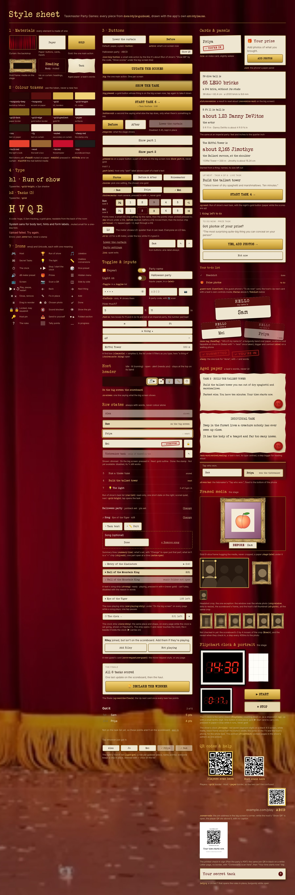

# Style guide

The look is a **Taskmaster-style studio**: red curtains, sepia paper, gold picture frames, a typewriter font. Everything should feel like a slightly theatrical, hand-made game show, not a web app. When adding something new, find the closest existing piece below and copy it. Each section links to screenshots in [docs/screens](screens/README.md) that show it in the real app.

*The style sheet: the materials, tokens, type, icons and every component below, drawn with the app's own `src/styles.css` and components.*

All styling lives in `src/styles.css` (no CSS framework, no CSS-in-JS). The colours are tokens on `:root`. Use the token, not a new hex value.

## 1. The materials

Think of the UI as six physical materials. Every element is made of one of them.

| Material | Used for | Recipe |
|---|---|---|
| **Curtain** (backdrop) | Page background everywhere | `--bg-image` under a dark red tint; `--burgundy-deep` as the fallback colour. Already on `body` (a fixed layer, so only content scrolls); don't paint over it. A big-screen `.stage` lights that same layer (lighter tint, vignette) rather than painting a second curtain. |
| **Paper** | Buttons, inputs, cards, labels, notices | `background: var(--paper)`, `color: var(--ink)`, `border: 2px solid var(--gold-dark)`, drop shadow |
| **Gold** | The main action, the active choice | `--gold-gradient` fill + `--gold-edge` border (see §3) |
| **Gold frame** | Every photo or video on the stage | `border-image: url("./assets/frame.png")` (the `.frame` / `.review .pic` recipe) |
| **Ink on curtain** | Headings and text sitting straight on the backdrop | `--gold-bright` headings, `--fg` body, `--muted` secondary |
| **Aged paper** | The words of a task: the task card, a Secret Task typed out | Mottled cream gradient, torn edges, typewriter in `#1f1a14`, the red wax seal (see §3 Aged paper) |

Rule of thumb: text never sits on a flat grey or white box. If it needs a surface, it's **paper**. If it's the thing to press, it's **gold**.

## 2. Colour tokens

| Token | Value | Use |
|---|---|---|
| `--burgundy-deep` | `#2a0807` | Fallback backdrop colour |
| `--burgundy` | `#580f0d` | Accent text **on paper**: slot headings, stage-label step name, captions, progress bars |
| `--gold` | `#d9b24c` | `h2`, the `&`, QR borders, preview borders, range sliders |
| `--gold-bright` | `#f3d37a` | `h1`, the big join code, phone headers, "now playing" |
| `--gold-dark` | `#8a6a1f` | The 2px border on every paper element |
| `--gold-edge` | `#7a5a14` | Border of gold buttons |
| `--gold-gradient` | `#f3d37a → #d9b24c → #b8902f` | Fill of gold buttons (`.big`, `.active`) |
| `--paper` | `#efe6d2` | Surfaces |
| `--ink` | `#2b1d12` | Text on paper |
| `--fg` | `#f6ecd6` | Body text on the curtain |
| `--muted` | `#c9b48f` | Secondary text on the curtain, labels, link buttons |
| `--stamp-red` | `#a8201a` | The stamp's ink: "done" (✓ You're in, ✓ Submitted). Only on the stamp. |
| `--ok` | `#9be08a` | Reserved; not used yet. Prefer the red stamp for "done". |
| `--bulb-red` | `#e8412e` | The light's red bulb (`/light`) and its glow. Not for text or UI. |
| (per trigger) | see `src/light/triggers.ts` | "All at once" bulbs: each trigger's `colour`, passed to the bulb as `--bulb`. They live in code, not here, because the Hue lamps need them too. |
| `--wood` / `--wood-dark` | `#9a6634` / `#5e3a18` | The wooden box under the bulb (fill / edges and grain). |
| `--tm-red` | `#c8102e` | Taskmaster red: the Noisemaster soundboard. Not for text. |
| `--key` | `#1e1d1c` | The soundboard's near-black buttons. |

Colours in use that don't have a token yet. Reuse these exact values, and promote them to tokens if you touch them:

- `#7a6a55`: muted text **on paper** (`.status`, `button .muted`)
- `#6b5a44`: hint text inside a paper slot (`.slot-hint`)
- `#8b7a63`: input placeholder
- `#ff9c8a`: error text (`.error`), always on the curtain
- `#1a0f08`: the dark mat behind framed media
- `#e6d6b0`: paper **pressed in** (a marked chip, the row on the big screen)
- `#e3d6ba`: the track of an upload progress bar
- `#ffffff22`: the hairlines between rows of a `.run-list` (Run of show's task list, the import check)
- `#f4ecd6 → #e9dcbc → #d9c79c`: aged paper's radial gradient; `#1f1a14` is its ink
- `#e2433a → #b51d17 → #7d0f0b`, rings `#a81a14` / `#6c0c08`: the wax seal (stage task card, envelopes)
- `#fff`: QR code backgrounds and the envelope's white only

Contrast note: `--muted` is for the dark backdrop only. On paper, use `#7a6a55` / `#6b5a44` instead.

## 3. Components

### Buttons
- **Default** is paper: typewriter font, 2px `--gold-dark` border, 6px radius, a `0 3px 0` hard shadow that "presses in" on `:active` (`translateY(2px)`). Already styled on the bare `button` element, so a plain `<button>` needs no class.
- **Primary** (`.big`): the one main action on a screen (Start a session, Join, Submit). Full-width gold gradient, uppercase, bold. **One per screen.** A gold button that puts something on the big screen ("Show the task") stays pressed in while it's up (`button.big.pressed`), and tapping it again takes it down.
- **A second line** (`.button-sub`, a `` inside the button): what else the tap does, in small sentence case under the label, normal weight. Only when there is something to say: Up next's Start reads "♪ Task fanfare · 0:08" under it when the task opens with a sting, and nothing otherwise. The ♪ is enough; no verb.
- **Selected / active** (`button.active`): the same gold as the primary button, for what's currently on screen or playing (stage steps, the current track, the backup stage controls). One shared rule, `button.big, button.active`, supplies the gold; adding `active` to any button is all it takes.
- **Choices** (`.choices`): picking one of several *settings* (the game, the light's mode and its secret, the Box round's players). A compact, wrapping row of paper chips, three to a row (`.choices.two` for long labels), the chosen one `.active` with `aria-pressed`. Smaller than `.steps`, which are for what the stage shows right now.
- **Marks** (`.choices.marks`): marking several things true at once, like Secret Tasks' scoring ("Did Sam do it?", "Who guessed it?"). The same paper chips, but a marked one stays pressed in, with a ✓ and `aria-pressed`, and never turns gold, so gold stays on the screen's one next action.
- **DQ chip** (`.choices.marks.sb-dq`): one small chip, the same size on every points row, right after the contestant's name so it reads as being about the person, not their score. Pressed in while they're DQ'd.
- **Points chips** (`.choices.marks.sb-chips`): a contestant's points on the scoreboard, "1 2 3 4 5" after the DQ chip, one line per contestant. There's no typed-in number: points typed before the bonus (0, 6, 2.5) still count and show as one more pressed chip until tapped away. The picked chip is pressed in like a mark. A DQ'd contestant's points stay on their chip, struck through and faded (`.was`); a **dashed** chip (`.before`) is what someone had before a DQ moved them up, explained by a key under the list. DQ is only ever on the host's screens.
- **Bonus chip** (`.choices.marks.sb-bonus`): "+1" at the far end of every points row, by hand or measured, the DQ chip's size. Bonus points on top of whatever they scored: each tap goes "+1", "+2", then none, pressed in (and reading "+1" or "+2") while they have them. It sits apart from the 1–5 chips so it doesn't read as a sixth score, and at the end because it goes on top of the score, where DQ sits by the name because it's about the person. A DQ keeps the bonus. "now N" includes it and the status line adds them up ("3 of 6 scored · 3 bonus points"). The big screen only shows totals. See: [scoreboard-host-points.jpg](screens/scoreboard-host-points.jpg).
- **Measured rows** (`.sb-measured`): the DQ chip by the name, a number box per contestant, the unit (or Noisemaster's "↺ 2") after it, the points over the place ("4" over "2nd") as a quiet button that opens the points chips (1 to 5), then the bonus chip. On a phone the gaps are tight (0.35rem) so a Noisemaster time still fits its box. One subgrid, so the columns line up. A point set by hand carries a small ✎; a small dashed number beside the points is the one before a DQ. A DQ'd row strikes its number through; one a dB task's DQ line made says "over 60" under its 0 instead of "DQ". On a lowest-wins dB task, a small LO chip (`.sb-lo`) opens under the box while it's typed in, for the meter's LO (see [scoreboard-host-points-db-dq.jpg](screens/scoreboard-host-points-db-dq.jpg), [scoreboard-host-points-db-lo.jpg](screens/scoreboard-host-points-db-lo.jpg)). On a wide iPad the name column fits the longest name and the box keeps a fixed width, so DQ and the points stay by the name. The light's page has "got it 2nd" or a muted "not yet" (`.sb-got`) where the box goes, since its order is marked on 💡, and a "Change the order on 💡 The light" link under the rows. See: [scoreboard-host-points-light.jpg](screens/scoreboard-host-points-light.jpg).
- **"Got it" list** (`.light-got`, `GotIt` in `LightRemote.tsx`): on the 💡 page, who has worked out the light's secret, in the order the host tapped them. A row per guesser, "2nd Priya 4 pts", the points in `--gold-bright` so the host can read them out. Under it a paper chip per contestant, alphabetical; tapping one adds them as the next place. Someone on the list keeps their chip in the same spot, dimmed (0.55) with a ✓, so the names never move. Tapping a row or a dimmed chip opens the row: the places as `.choices.marks` (the current one pressed in) to move them, and "Take Tom off the list". While the light is on the task list the points are the scoreboard's, and a DQ there strikes the name through with "DQ" for the points; until then a muted line says the points aren't on the scoreboard, with an "Add it" link (Noisemaster's done line has the same nudge). See: [host-light-got-it.jpg](screens/host-light-got-it.jpg), [host-light-got-it-fix.jpg](screens/host-light-got-it-fix.jpg), [host-light-got-it-dq.jpg](screens/host-light-got-it-dq.jpg), [noisemaster-host-kept.jpg](screens/noisemaster-host-kept.jpg).
- **Link** (`.link`): no chrome, `--muted`, underlined. For quiet or escape actions: Not Alex? Not the right party?, Disconnect, End session, Lower the curtain, Reset.
- **Icon button** (`.picker .x`, `.picker .lock`): a small paper square next to a row. Always give it an `aria-label`.
- **Disabled**: `opacity: 0.45`, `not-allowed` cursor. Prefer disabling to hiding when the button's position matters (see §5).

See: [host-choose-game.jpg](screens/host-choose-game.jpg) (paper, gold, `.steps`), [host-box-setup.jpg](screens/host-box-setup.jpg) (`.choices`), [checkin-phone-confirm.jpg](screens/checkin-phone-confirm.jpg) (one gold button), [host-collecting-entries.jpg](screens/host-collecting-entries.jpg) (the stamp, 🔒/🔓).

### Toggles
Any on/off setting is a **switch**, not a button whose label flips between "Show" and "Hide". Use `<Toggle label on onChange />` (`src/Toggle.tsx`) and stack them in a `.toggles` list: typewriter label on the left, a switch on the right (a wooden slot that fills gold when on, with a paper knob). Label it with what it controls, stated positively, so on means "shown" or "running" ("🔁 Repeat", "Light on"). Buttons stay for actions and for choosing one of several (`.active`).

See: [host-party-settings.jpg](screens/host-party-settings.jpg) (the night-of switches).

### Inputs
Paper background, `--gold-dark` border, 6px radius, full width. Wrap them in a `<label>`: labels are a grid with `--muted` text above the field. A find box (`.clearable` around the input) has a × at its right end that empties it, and filters the list under it as you type, ignoring case and accents ("Find a thing…"; the useless units, from "a thing ▾"). Pin inputs are `<PinField>` (`src/HostPin.tsx`): typewriter digits with 0.3em tracking and a 👁 inside the field's right end that shows them; hidden as dots by default, except while choosing a new pin. Party-code inputs use the typewriter font with wide letter spacing (`0.3em`), uppercase, `maxLength={4}`, `placeholder="ABCD"`, plus a 📷 scan button beside them in a `.row`.

See: [host-pin-connect.jpg](screens/host-pin-connect.jpg) (pin), [guest-join-code.jpg](screens/guest-join-code.jpg) (party code).

### Cards and panels
- **Player tile** (`.tile`): an index card, 3px radius, **slightly rotated** (`-1deg`, `1.2deg`, `-0.4deg` by position). On hover it straightens, grows 4% and gets a gold ring.
- **Slot** (`.slot`): the phone's paper panel. The heading is `--burgundy`, the hints are `#6b5a44`.
- **Read-aloud card** (`.slot.conversion`, and `.conversion-card` on the big screen): the three lines of a useless conversion on plain paper: the lead and the "what was measured" line in typewriter ink, the result between them in large `--burgundy` typewriter. On the big screen it hangs on the curtain like a photo (§6). A sound is always "about", rounded to two figures, and counted "at once" ("about 26 garbage disposals at once"). At an imperial party (§ Plan the party) the working line explains in US units, written the way they're said or labelled: under an inch a decimal ("0.03 in"), then inches and feet to the nearest quarter inch with ¼ ½ ¾ ("4 ¾ in", "2 ft ½ in", "3 ft"), past a mile miles; ounces to the nearest quarter ("10 ½ oz"), from 1 lb to under 4 lb total ounces then pounds and ounces ("24 oz (1 lb 8 oz)", the NIST label rule), from 4 lb decimal pounds ("5.25 lb"), then tons; fl oz, cups, gallons. A lead typed in ft or in from a foot up reads "5 ft 6 in tall is", one in lb or oz "1 lb 8 oz is" (no total ounces: it's said aloud). See: [converter-host-feet-inches.jpg](screens/converter-host-feet-inches.jpg), [converter-host-pounds-ounces.jpg](screens/converter-host-pounds-ounces.jpg). See: [converter-host-result.jpg](screens/converter-host-result.jpg), [converter-main-whole.jpg](screens/converter-main-whole.jpg), [converter-main-loudness.jpg](screens/converter-main-loudness.jpg).
- **Floating label** (`.stage-label`, `.review-name`, `.review-loading`, `.sound-hint`): a paper strip over the stage, typewriter font, centred, with a drop shadow.

### Row states
Lists of people, tasks and photos on the host remote use the same handful of states. Reuse them rather than inventing a colour:

| State | Look | Where |
|---|---|---|
| Already shown | Dimmed to `opacity: 0.55` | The running order |
| Next up | 3px `--gold` outline in the running order; on Run of show's task list the row turns `--gold-bright`, with "next" on the right | The running order, Run of show's task list |
| On the big screen now | **Pressed in**: down 2px, inset shadow, `#e6d6b0` fill, bold, plus "on the big screen" in words | Headshot task's list (`li.up`), the same as a marked chip (§ Marks); "Show part N" on a multi-part task |
| On the big screen now (a photo) | Gold ring: `--gold-edge` border and a `--gold-bright` glow | Prize task's previews |
| The chosen one | A small gold `★` disc in the corner; `☆` on the others moves it | Prize photos (the one the haul shows) |
| Already used | Disabled, with a small uppercase "on the list" label inside | "+ App task" choices |
| Can't play | Disabled, with the reason in words where the song's length goes ("music folder not open", "not in the music folder", "after the transition" while a task's transition sound plays) | A task's song strip |
| Playing | Pressed in (`.pressed-in`: down 2px, inset shadow, paper `#e6d6b0`, bold), ▶ becomes ⏸. Never gold: gold stays on the next thing to do | A task's song strip, the jukebox's current song |
| Disqualified | DQ chip pressed in; what they'd have had struck through and faded (`.was`), never removed | The points page |
| Over a dB task's line | The same DQ, with "over 60" under the 0 instead of "DQ" | The points page |
| Before a DQ moved them | A dashed outline (`.before`, `.sb-before`), with a key under the list | The points page |
| Bonus points | "+1" or "+2" chip pressed in, counted in "now N" and in "· 3 bonus points" | The points page |
| Not tappable but not unavailable | `.sb-task:disabled` keeps full opacity: the row is just information | Task rows on Plan the party |

State is never colour alone: each one also has its words (✓, "next", "on the big screen", "scored", "not yet").

See: [scoreboard-host-points-dq.jpg](screens/scoreboard-host-points-dq.jpg), [scoreboard-host-points-measured.jpg](screens/scoreboard-host-points-measured.jpg), [headshot-task-host-up.jpg](screens/headshot-task-host-up.jpg), [prize-host-up.jpg](screens/prize-host-up.jpg), [run-of-show-host-add-game.jpg](screens/run-of-show-host-add-game.jpg).

### Help
`.help-q`: a circled `?` beside a heading, drawn in `currentColor` with no fill. It opens an explanation in place, and fills `--burgundy` while open (`aria-expanded`). Use it when the rules are worth having but not worth showing every time (Secret Tasks' envelope rules). See: [secret-tasks-player-rules.jpg](screens/secret-tasks-player-rules.jpg).

### Aged paper
The **task card** (`.task-card`, `TaskCard.tsx`) is what a task is written on: aged, slightly mottled paper (a radial gradient `#f4ecd6 → #e9dcbc → #d9c79c`) with **torn edges** (a `clip-path` polygon), typewriter text in `#1f1a14`, a deep drop shadow, and the red TM **wax seal** (`.wax-seal`) in its bottom-right corner. `.task-card.small` is the same card at phone size. The same paper, without the tear, is the card a Secret Task is typed on (`.env-letter`, `.finale-card`), where the heading is uppercase `--burgundy`. Use it only for **the words of a task**, never for UI: controls stay on ordinary paper.

A task's own **task text** goes on the same card: `.task-card.centred` centres its type at the top (INDIVIDUAL TASK, TIEBREAKER TASK; no type, no label), and every line the host wrote is its own paragraph. On the host's phone it's `.task-card.small.reading`, a step bigger (1.15rem) for reading aloud in a dim room. On the big screen (`.task-text-stage`) it's centred on the curtain and its type shrinks (`--text-size`, from 3vh) until the whole text fits, so the screen never scrolls. The tiebreaker's fixed bar for who won mid-story is under Host remote (§5).

See: [main-collecting-entries.jpg](screens/main-collecting-entries.jpg), [secret-tasks-player-envelope.jpg](screens/secret-tasks-player-envelope.jpg), [main-task-text.jpg](screens/main-task-text.jpg), [tiebreaker-host-text.jpg](screens/tiebreaker-host-text.jpg).

### Hidden menu
`.lobby-menu` (`LobbyMenu` in `Screen.tsx`, borrowed from tm-scoreboard): a paper `☰ Menu` button fixed in the top-left corner, invisible until the mouse comes near. It opens a burgundy panel with a 3px `--gold` border for setup hints and quiet exits (host remote status, `/screen` and `/light` hints, End session). Escape or a click outside closes it. Put anything the room doesn't need to read here instead of under the players.

See: [main-hidden-menu.jpg](screens/main-hidden-menu.jpg).

### Stamp
`.stamp` is a red-ink rubber stamp tilted `-4deg`: uppercase, bold, 3px `--stamp-red` border, a faint red fill. It's the **one** visual for "done", and it always carries a ✓ and words (✓ You're in, ✓ Submitted). Don't invent a second "success" style. Red works here because it's the show's own ink (the red seal), not a warning, so **errors never look like a stamp**: they're plain `.error` text, with no border, tilt or ✓.

### Framed media
Photos and videos on the stage are **always** in the gold frame (`frame.png` as a 9-slice `border-image`). The frame hugs the media's real aspect ratio (`--ratio`, set on load) and grows to the largest size that fits. Never crop the media (`object-fit: contain`). On phones, previews get a simpler 3px `--gold` border instead.

**Headshot crops are the one exception, and only on the scoreboard and the host's thumbnails.** The scoreboard's window (140 by 184 inside its frame) always crops a headshot; the host can choose which part (`crop` beside `photo`, as shares of the photo; `cropFill` in `src/scoreboard/crop.ts` draws it), and with none it's centred, as it always was. The stored photo is never changed. The host remote's headshot thumbnails (Plan the party's contestants, the arrivals list) take the window's shape and show the same crop, so the list and the TV can't disagree. The Headshot task, the photo grid, the prize haul and the guest phone show the whole photo. A new photo clears its crop. See: [headshot-crop-scoreboard.jpg](screens/headshot-crop-scoreboard.jpg).

**Not checked in yet: a mosaic.** On the big screen's scoreboard, anyone with a headshot who hasn't checked in is a 3 by 4 mosaic of their crop (`Mosaic.tsx`: each block the average colour of what it covers, drawn on a canvas blown up with `image-rendering: pixelated`, so the blocks stay sharp), so the room can guess who's still coming. Nothing else changes: the frame, the sway, the seal and the order. When they check in it sharpens a step every 400ms (3×4, 6×8, 12×16, 24×32, 48×64, then the photo: 2s, like the scores ticking up); turning the switch off plays the same reveal for everyone still pixelated. A face that's sharp when the scoreboard comes up never animates. Only the big screen: the host's thumbnails and the guest's phone always show the face. On unless the host turns off "Pixelate until checked in" in Plan the party (`scoreboard/pixelate: false`). See: [pixelate-main-arriving.jpg](screens/pixelate-main-arriving.jpg), [pixelate-main-reveal.jpg](screens/pixelate-main-reveal.jpg).

See: [headshot-task-main-everyone.jpg](screens/headshot-task-main-everyone.jpg), [prize-main-photo.jpg](screens/prize-main-photo.jpg).

### Flipchart clock and portrait
The Flipchart task has two materials of its own. **The clock** (`src/clock/FlipClock.tsx`, `.fc-clock`; it's the party's clock, also the host's ⏱) copies the show's: red seven-segment digits (`#ff2b1c`, unlit segments a dark red) on a black screen kept to a 4:3 iPad shape, in a white matte (`#f3efe6`), in a black frame about half the matte's width. It's the same clock on the big screen (about the height of the screen, the one focus; it never hides or moves) and on the host's phone, and keeps this look the whole task. As a stopwatch (`up`) it counts up with a small tenths digit after a dot. **The portrait** (`Portrait`, `.fc-portrait`) is sixteen A1-shaped pages (1 : 1.414) laid out four by four in the show's pattern, pages 3, 9, 10 and 16 turned half way round, drawn from strokes (never a stored image), and it's framed like any media on the stage and in "everyone". On the reveal the pages land upside down one at a time, a little skewed, then all slide into place together. The guest's pad (`.flipchart`) is one white page under a grey binding strip; markers are black, red, blue and green (`MARKERS`), pages are turned with plain ← and →, and never numbered. See: [flipchart-main-clock.jpg](screens/flipchart-main-clock.jpg), [flipchart-main-portrait.jpg](screens/flipchart-main-portrait.jpg), [flipchart-guest-drawing.jpg](screens/flipchart-guest-drawing.jpg).

### QR codes
White background, 6px `--gold` border (`--paper` border for the host QR, so the two can't be confused), with a typewriter caption underneath ("Players scan here" / "Host scans here").

**Printed**, on the check-in sign (§ Plan the party), the join QR is plain black on white paper with no border, about 3¾ in square, captioned "Contestants scan here". See: [checkin-sign-pdf.jpg](screens/checkin-sign-pdf.jpg).

See: [main-welcome.jpg](screens/main-welcome.jpg).

## 4. Type

- **Typewriter** (`var(--typewriter)`, Veteran Typewriter): all headings, buttons, captions, labels on the stage, codes and "now playing". This is the show's voice.
- **System sans** (`system-ui`): body text, hints, form labels, errors. It keeps long text readable.
- Headings: `h1` in `--gold-bright` with a `0 2px 0` shadow; `h2` in `--gold`. Normal weight, slight letter spacing (`0.04em`).
- Uppercase + letter spacing is for **short labels only**: the stamp, statuses, the stage step name, primary buttons.
- Codes are huge and spaced out: `5.5rem`, `0.3em` tracking, a gold glow. They have to be readable from the back of the room.
- Numbers that change in place (durations, counts) use `font-variant-numeric: tabular-nums`.

## 5. The three screens

Each screen has its own rules. Know which one you're designing for.

### Stage (`/`: the TV)
- Seen from across a room. Size things in **viewport units** (`vmin`, `vh`, `clamp()`), not px, so they scale with the TV.
- During a reveal the **media is the whole show**: full screen, framed, with nothing but the small paper label at the bottom.
- No visible controls. The backup `.stage-controls` bar only fades in while the mouse moves, and the cursor hides when idle. Keyboard shortcuts mirror the host remote.
- Never show browser media controls on the stage.
- On the curtain and while entries come in, the join address sits small in the bottom-right corner (`.corner-code`: "site/play · ABCD" in `--muted`, the code in gold typewriter), so a late guest can still join. While the host remote's "Show QR" is open, the join QR (24vh, `--gold` border, no caption: the address underneath is its caption) sits just above it.
- **Prize haul** (`.haul`): the finale. "Prize Haul" as a huge typewriter `h1` across the top, the winner's headshot in the largest gold frame in the centre with a paper placard ("Priya is the winner!"), and each prize's ★ photo in smaller frames around it, each with a small "from Sam" placard. The prizes hang one by one from the centre outwards.
- **The scoreboard is the one exception to the curtain.** It's ported as is from tm-scoreboard (`src/scoreboard/scoreboard.css`, VodBox, MIT): its own sepia typewriter photo (`assets/background.jpg`), each contestant's headshot in a gold frame (cropped as the host chose, § Framed media) over their score on a red wax seal, sorted with the leader scaled up, sliding to new places over 2s. It's sized in fixed px and scaled to the screen. Leave its look alone so it stays the show's own; new stage screens follow the curtain rules above, not this one.

See: [main-welcome.jpg](screens/main-welcome.jpg), [main-collecting-entries.jpg](screens/main-collecting-entries.jpg), [headshot-task-main.jpg](screens/headshot-task-main.jpg), [main-prize-haul.jpg](screens/main-prize-haul.jpg), [scoreboard-main-after.jpg](screens/scoreboard-main-after.jpg).

### Player phone (`/play`)
- One column, `max-width: 480px`, `gap: 1rem`. Big tap targets (the default button padding is the minimum).
- **The guest phone is the host remote's layout** (`src/guest.tsx`): the title (`.guest-head`: their name, small muted "Halloween party · HVQB" under it), one `.on-screen` status line saying where they stand, at most one **"To do now" card** (`.guest-card`, `GuestCard`) holding the only gold button, "Your to-do list" as quiet `.run-list` rows, and quiet `.run-links` at the bottom. No header icons, summary lines or chips. Always say what state they're in, in plain words.
- **The card carries a task's own controls unchanged**: label in small capitals ("Task 2 of 8 · Photos", "To do now · Prize task", "On the guest list"), the name as the heading, the task's words in quotes exactly as the host wrote them (`Quote`: never a paraphrase, never two versions of one task), then the controls. A task that's on takes the card; the to-dos stay as rows. Once their part is sent the card stays as the receipt (stamp, photo, 🔒 line) until the next task.
- **Status lines** (`Status`): "Checking in · step 2 of 3" while checking in (this guest's own steps only); "1 thing left to do"; "It's task time. Send your photo."; "Photo sent. Put your phone away. People are starting to stare." (or "…1 thing left to do."). With nothing left there is no card and no gold, and the line goes a size up (`.on-screen.big`) with the muted "When the host starts a task, it'll show up here." under it. Say "task", never "game". Watching a Noisemaster or Box turn: no card, the status line says who's up ("Alex is at the soundboard. Watch the big screen.").
- **To-do rows** (`TodoList`): "Headshot · done", "Secret envelope · to do / picked", "Prize photos · to do / optional / ✓ sent / 🔒 presented". The row being worked on is `--gold-bright`; tapping a row opens it in the card's place with "← Back". The prize is asked as a question ("Got photos of your prize?", gold "Yes, add photos →", paper "Not now"); "Not now" makes it an optional row that doesn't block "all set".
- **Name tags** (`.name-tag`, `NameTag`): a burgundy band with "HELLO" in typewriter and "my name is", over paper with the name in typewriter, gently tilted. At check-in they're scattered on the curtain, about two to a row in name order, under "Find your name tag and tap it"; a tag already taken is faded with "✓ here" and stays tappable (a guest moving phones). While a guest waits with no card, their own tag (`.mine`, centred, tilted about −3°) replaces the plain name title; any card brings the plain title back. A red stamp is never used for "all set": the stamp means "your entry went in".
- **Check-in, in order**: tap your name; "You're Sam?" on the card with the host's headshot in a gold frame and under it the Headshot task's words (or "Your headshot for the scoreboard."), gold "That's me", "Not me" below (a guest can't replace a headshot the host set, so this is the headshot step); with no headshot on file, the "To do now" card "Add your headshot" in the same frame with two paper buttons and no gold until a photo is picked; if Secret Tasks is planned, the whole rules card (`TaskCard small`, the party's Secret Tasks Part 1) on the curtain with gold "Got it: pick an envelope →", then the pile on the curtain under "Pick an envelope" with a circled `?` that lays the same rules card over the pile so nothing moves. "You're in" only appears once every step is done.
- Keep the main action (`.big`) near their thumb, and put quiet exits (`.link`) at the bottom.

See: [guest-home-waiting.jpg](screens/guest-home-waiting.jpg), [guest-home-prize-ask.jpg](screens/guest-home-prize-ask.jpg), [guest-checkin-list.jpg](screens/guest-checkin-list.jpg), [guest-checkin-confirm.jpg](screens/guest-checkin-confirm.jpg), [guest-task-photos.jpg](screens/guest-task-photos.jpg), [guest-prize-photos.jpg](screens/guest-prize-photos.jpg), [guest-noisemaster-up.jpg](screens/guest-noisemaster-up.jpg).

### Host remote (`/host`)
- Same phone column, but it's a **control panel**: every control keeps its position on every view. Disable controls that don't apply; don't remove them (see the comment in `HostRemote.tsx`).
- **Taking the remote on another phone** (`HostPin.tsx`, `HostPage.tsx`): the host's own other phone, days ahead with no big screen to scan, gets on with the code and the host pin. Once a pin is saved, Plan the party has a quiet "📤 Send yourself the host link" under it, which hands `site/host?code=ABCD` to the share sheet (copied, with a muted "Link copied" line, where there's none), so the host can tap it later and land on the pin step. The phone it was taken from goes back to its start page with "Another phone took over Halloween party · ABCD." and gold **Take it back** above "Start a new party"; it says "another phone" because the app can't tell whose. Removing the remote from the big screen or with Disconnect says nothing. See: [host-pin-send-link.jpg](screens/host-pin-send-link.jpg), [host-taken-over.jpg](screens/host-taken-over.jpg).
- **Header** (`HostPage.tsx`): five icon buttons, right-aligned, in this order: 🎵 the jukebox (shows ▶ and glows while a song plays), ✉ Secret Tasks, 💡 the light (glows while it's on), 📏 Useless conversions (glows while a conversion is on the big screen), ⏱ The clock (glows while it counts). The open one has a `--gold-bright` outline. It stays at the top of the screen while the page scrolls, on a band of `--burgundy-deep` (95%) that runs to the phone's edges, so it is always one tap away. Idle icons are faded and greyed (`.head-icon`); `.lit` is the gold glow, meaning "running"; `.alert` is a small burgundy dot, meaning "needs the host". Never use the glow for "needs you". There is no 🏆 and no "Host" label: Run of show is home, and its title carries the party name and code in small muted type. 🎵 ✉ 💡 📏 ⏱ open in place of the page with one "← Back" to where the host was, then the "On the big screen" line. A new all-evening feature gets a header icon, not another section on a page.
- **Arrivals** (`Arrivals` in `RunOfShow.tsx`): before the first task, "Here so far · 3 of 5" and a read-only list (`.arrivals-list`: a 2rem-wide headshot in the scoreboard window's shape, cropped as the scoreboard crops it, the name in typewriter, and a muted "checked in", "not yet" or "checked in · no headshot yet"; guests who haven't come are dimmed). No QR button of its own: "Show QR" by the code covers it, and the host prints the QR for the door (the check-in sign, § Plan the party).
- **New guest card** (`.move-request.new-guest`, in `HostPage.tsx`): the move-request card style, at the top of any page: the guest's name in bold, "joined, but isn't on the scoreboard. Add them if they're playing.", and two paper buttons, "Add Riley" and "Not playing".
- **The finale** (`.up-next.the-finale`): the Up next card once every task has points: "THE FINALE", "All 8 tasks scored", one line on what follows, and the night's gold "🏆 Declare the winner".
- **Now-playing strip** (`.sb-song.now-playing-strip`, in `OnScreen`): while a song plays, under the "On the big screen" line of every page: "⏸ Title" and "1:55 left", pressed in. One tap pauses it. It never goes gold.
- **Replay strip** (`ReplayStrip.tsx`, `.sb-song`): on a task's page, above its song strip, always there once the task has a transition, played or not: "♪ Task fanfare · 0:08 · 🖼 Dice tower ▶". One tap plays it again on the big screen; pressed in ("⏹ …") while it's on, and tapping then ends it. Disabled, the reason in words, while the music folder isn't open or none of its files are in the folder. See: [host-replay.jpg](screens/host-replay.jpg).
- **Transition strip** (in `OnScreen`, the now-playing strip's shape): while a task's transition is on, "⏹ Task fanfare" and "0:06 left" ("⏹ Dice tower picture" with no time for a picture on its own). One tap ends it, never pauses it. The status line above it names it: "Dice tower's transition picture". A **video holds its last frame** on the big screen when it ends, until the host puts anything else up or taps the strip, and the strip says "⏹ Spooky intro" and "last frame" in place of the time. The task's song strip is playable then (music is only sound, so it leaves the frame up), and the replay strip is back to ▶, which plays the video again from the start over the frame. "Try it" in ✎ holds the same way. Music alone ends when it ends. See: [host-sting.jpg](screens/host-sting.jpg), [host-sting-held.jpg](screens/host-sting-held.jpg).
- **Clock strip** (`.clock-strip`, in `OnScreen`): while the ⏱ clock is set going, shown on the big screen or Flipchart's, under the "On the big screen" line of every page (not on ⏱ itself, nor Flipchart's own task page, which has its clock): the song strip's shape, "⏱ The clock →" and "2:31 left" ("held · 1:12 left", "ready · 3:00", "time's up", a stopwatch's "0:17.3"). The strip opens ⏱ and never changes what the room sees, so a stray tap is harmless. A separate ⏸ beside it holds the clock (▶ carries on).
- **⏱ The clock** (`ClockRemote.tsx`): top to bottom, a paper "Show the clock" (pressed in while it's on the big screen, never gold: the host may show it before starting it, and the clock replaces whatever was up until the host puts something else up), "Count down · Stopwatch" (`.choices.two.marks`, locked once it has started), then for a countdown "From task 6, Dice tower" with the task's time limits read from its words, a part each, each with the sentence it came from (the part on the big screen is picked to start with), "Or any time" (1, 2, 5 and 10 min) and "Your own" in min and sec boxes (`.feet-in`, no colon on a phone's number pad), a "♪ Ends on: …" summary line (or "+ Song to end on") that starts a song on the main screen when the time left is its length (a longer song starts with the clock and plays on past 0:00), the clock, and **one button in one place**: gold "▶ Start" (and to carry on), pressed-in paper "⏸ Stop" while it runs (the song pauses with it). Quiet links under it: "+1 minute" (the song plays on) and "Reset". The time chips lock, dimmed, once it has started. A stopwatch swaps the times for contestant chips: the first tap with everyone going picks just that one, then each tap adds or takes away ("Everyone" picks them all again); while it runs a tap takes that contestant's time (it stays on their chip), a tap on a timed chip takes it back, and the clock stops itself when everyone going has one. Times go into a lowest-wins live task's results, in seconds; with no such task they stay on the page. The clock is never on guest phones. Flipchart's clock, while it runs, is the clock in the party: ⏱ shows it, read-only. See: [clock-host-set.jpg](screens/clock-host-set.jpg), [clock-host-song.jpg](screens/clock-host-song.jpg), [clock-host-running.jpg](screens/clock-host-running.jpg), [clock-host-task.jpg](screens/clock-host-task.jpg), [clock-host-stopwatch.jpg](screens/clock-host-stopwatch.jpg), [clock-host-flipchart.jpg](screens/clock-host-flipchart.jpg), [clock-main-countdown.jpg](screens/clock-main-countdown.jpg), [clock-main-stopwatch.jpg](screens/clock-main-stopwatch.jpg).
- **📏 Useless conversions** (`Converter.tsx`, wrapped for the party by `ConverterRemote.tsx`): top to bottom, a task's units (if any), the kinds, that kind's units, then "How much?" and gold "Surprise me", so the box follows the unit picked. At an imperial party a kind's US units come first (in ft mm cm m), each kind opens on ft, lb or cups, and ft or lb gets two boxes, ft and in or lb and oz (`.feet-in`), because a phone's number pad has no ' or ". The phone's remembered unit only counts if it's from the party's system. See: [converter-host-imperial-first.jpg](screens/converter-host-imperial-first.jpg).
  - **Start from a thing**: after the units, a full-width "a thing ▾" chip (`.choices.units .thing`) opens a find box and that kind's useless units, each with its size on the right ("Eiffel Tower · 330 m"). Picking one shows its name on the chip, and "How much?" becomes a count (1 to start). The card names it and leaves its size out, since the number spoils the joke: "The Eiffel Tower is", "2 Eiffel Towers are". The answer can be picked too, with the same find box and list: "Or pick one ▾" under "Surprise me" before the first result, "Use a different unit ▾" on the card after it (`FindThing`). A thing is never converted into itself. Beside "Use a different unit", a quiet "⇄ Flip it" (only when started from a thing; `.summary-links`) swaps the two: the answer becomes the thing, at 1, and the old start the answer ("Jimothy is about 1/2,165 the height of the Eiffel Tower"). If either side is an average, so is the result: never "exactly". See: [converter-host-flipped.jpg](screens/converter-host-flipped.jpg), [converter-host-find-thing.jpg](screens/converter-host-find-thing.jpg), [converter-host-thing.jpg](screens/converter-host-thing.jpg), [converter-main-jimothy.jpg](screens/converter-main-jimothy.jpg).
- **📏 without a party** (`/convert`, `ConverterPage.tsx`): the same converter on any phone, with the party taken out: no header, no "← Back" or status line, no tasks' units, no big screen. Where "Show on the big screen" would be, a "US units (ft, lb, cups)" switch (`Toggle`) stands in for the party's setting; the first visit follows the phone's region (US units in the US, Liberia and Myanmar), then the switch is remembered on the phone, as is the last unit. Flipped mid-result, the result stays: 1 ft 2 in folds into the one box (1.17 ft) and the answer keeps its unit. The way in is a quiet link under the host remote's recent parties, "📏 Useless conversions, no party needed". See: [converter-alone-open.jpg](screens/converter-alone-open.jpg), [converter-alone-result.jpg](screens/converter-alone-result.jpg), [host-start-convert.jpg](screens/host-start-convert.jpg).
- **Read it out** (`ReadOut.tsx`): a quiet "📏 Read it out" under a measured task's points. It opens contestant chips (whoever's number was typed last is picked), the useless-conversion card with "Surprise me again", and a paper "Show on the big screen" that is pressed in ("On the big screen · Jordan") while it's up. Picking another contestant while it's up swaps the big screen to theirs.
- **Home is the run of show** (`RunOfShow.tsx`). Every party opens on it, and it's for running the night, not building it. Top to bottom:
  1. `Run of show` heading, then the party line ("Halloween party · ABCD", small and muted) with a small paper **"Show QR"** chip at its right, then one `.on-screen` line saying what the big screen shows ("On the big screen: the curtain", "…: the scores, before Photos: best costume", "…: not connected yet"), with a small paper **"Show scores"** chip under it, left-aligned, while the scores, the haul and the winner aren't up. Then at most one `.muted.small` line. Both are **line chips** (`.line-chip-button`): side actions that change the big screen, so they sit by the line they're about, small, never gold and never full width. "Show scores" goes under its line, not beside it, because that line runs long. They're not in the header: its icons open a page, and these act the moment they're tapped. See: [run-of-show-host.jpg](screens/run-of-show-host.jpg).
  2. **The top slot: the one next thing in gold.** While the scores are up it's the scoreboard's next step: "Update the scores" (the status line names what it adds, so the button stays one line), then "Lower the curtain"; "🎁 Show the prize haul · Priya"; "Play the tiebreaker task · Sam and Priya". The quiet way out sits under it as a `.link`.
  3. **The "Up next" card** (`.up-next`): a paper card with "Up next · task 4 of 8 · live task" in small capitals, the task's name, the first lines of its note in quotes, and the night's gold button: "Start task 4 →", "▶ Start Photos: best costume" for an app task, or "Open task 4 →" for a task half-scored, already on, or the light. A task with a transition has it as the Start button's second line, "♪ Task fanfare · 0:08 · 🖼 Dice tower" or "▶ Drumroll cam · 0:12": the tap plays it on the big screen at once ([up-next-transition.jpg](screens/up-next-transition.jpg)); "Open task 4 →" never plays it, so it never shows it. A piece gone from its folder is struck through and greyed, "not found" after it; with the music folder closed the whole line is greyed, "· music folder not open". Start still works and skips it ([up-next-transition-missing.jpg](screens/up-next-transition-missing.jpg)). While the top slot has the gold, the card's button is paper; starting it then brings the scores down too.
  4. **All tasks** (`.run-list`): read-only rows, a number, the name and one short state on the right ("scored", "next", "playing", "3 of 8 got it", "1 of 8 prizes in"). Scored rows are quiet, the next one is `--gold-bright`. Tapping a row opens that task's page, for running one out of order. No ≡, ✎ or ▶ here.
  5. A quiet "End the night now: declare the winner" under the list (the night can end before every task is played: one last update, then the haul).
  6. Quiet links at the bottom (`.run-links`): "Play a task that's not on the list" (or "Back to [BLANK] in a Box" while one is on), "Plan the party", "Party settings" (the download button, "Reset scores…" and Disconnect). "Reset scores…" opens in place in an `.extra-open` panel: a **Clears** sentence and a muted **Keeps** sentence, counted for the party, an "Also remove guests" switch (off to start), then a paper button named for what it does and a `confirm()`. Never gold: a reset is never the night's next step. After it, the big screen goes back to the curtain. See: [host-reset-scores.jpg](screens/host-reset-scores.jpg).
- **One task page for every task** (`TaskPage.tsx`), live task or app task: "← Run of show", the task as the `h1` (`.task-head`) with "Task 4 of 8 · live task" under it, the `.on-screen` line, then:
  - gold **"Show the task"** on an **app task** with text: putting the words up is usually what comes next. While they're up it's pressed in (`button.big.pressed`: down 2px, inset shadow, a little darker), and tapping it again lowers the curtain. On an app task the gold moves on to its next step once the words have been up;
  - **Secret Tasks** is the exception: it's the night's last task, where the envelopes are revealed, and its words are already on paper or on guests' phones. It has a paper (never gold) "Show the task" that puts **Part 2**, the reveal's words, on the big screen, and no task card on the page, so the reveal's gold "First up: Sam →" is the one next step. With no Part 2 there's no "Show the task". See: [secret-reveal-host-title.jpg](screens/secret-reveal-host-title.jpg), [secret-reveal-main-part2.jpg](screens/secret-reveal-main-part2.jpg);
  - a **live task or the tiebreaker** with text (one part, or several: pieces each with their own heading, like an Individual part then a Team part) has no "Show the task". It has two rows of **radio buttons** (`.part-pick`, `role="radiogroup"`, each a `.choices.marks` row on one line): "BIG SCREEN" and "PHONES", each choosing **Nothing**, **Part 1**, **Part 2**… (**The task** when there is only one part) The chosen one is pressed in, never gold: putting a part up is the host's choice, and so is putting none up. The two rows are independent: part 1 can be on the big screen while part 2 is on the phones. Picking Nothing on the big screen lowers the curtain; picking another part swaps it. The `.on-screen` line says "the task, part 2". The cards sit under the rows, to read from. **On a phone** the words are the same paper task card as on the host's phone (`TaskTextCard`: the part's own centred heading, the words as written), with no task name and no "Part N", under a status line "Here's the task. Read it, then put your phone away." (`phoneWordsOf`). **"Part N" is host-remote wording only**: the cards, the big screen, guests' phones and the PDF never say it, only each part's own heading. See: [task-parts-host.jpg](screens/task-parts-host.jpg), [task-parts-host-up.jpg](screens/task-parts-host-up.jpg), [task-parts-host-phones.jpg](screens/task-parts-host-phones.jpg), [task-parts-main.jpg](screens/task-parts-main.jpg), [guest-task-parts-phone.jpg](screens/guest-task-parts-phone.jpg);
  - the song strip (`SongStrip.tsx`, `.sb-song`: "♪ title ▶ 2:40", a small remote for the jukebox), the host's note, and the task card to read from;
  - for an app task, its own controls, unchanged: gold "First up: Sam →", the running order, "◫ Show everyone". A contestant on the big screen gets their own controls a step inside, and lowering the curtain comes back here. Once everyone has been shown, the gold button gives way to a muted "All 5 shown." An app task that isn't on yet has "▶ Start Photos: best costume" (gold until it has points);
  - **Points**, always open at the bottom (`Points.tsx`), and once everyone has points, gold "Done: back to Run of show →". Secret Tasks has no point chips: the reveal works the points out ("Did Sam do it?", "Who guessed it?"), and "Lower the curtain", at the end or partway through, puts them on the scoreboard; its Points section is only the status line, "4 of 6 scored · from the reveal, when you lower the curtain".
  A task that's not on the list uses the same page with no number and no points ("Not on the run of show, so it isn't scored"), and the tiebreaker's page has the same top, with the tied contestants under its title.
- **The tiebreaker's bar** (`.sb-won-bar`): on the tiebreaker's page only, "Tap who won." and the tied contestants side by side sit in a burgundy bar with a 3px `--gold` top border, fixed to the bottom of the screen, so the winner is one tap away however far the story has scrolled. Tapping who won scrolls back up to gold "🎁 Show the prize haul · Sam" under the status line. Other tasks are scored after the reading, so they have no bar. See: [tiebreaker-host-text.jpg](screens/tiebreaker-host-text.jpg), [tiebreaker-host-text-won.jpg](screens/tiebreaker-host-text-won.jpg).
- **Task type and text in ✎** (`TaskText.tsx`): under "Task text", "Task type (optional)" as `.choices` (Individual, Team, Other… for the host's own word) with a muted line spelling out the heading, then "Task text (optional)", a plain box that grows with what's pasted. See: [run-of-show-host-task-text-edit.jpg](screens/run-of-show-host-task-text-edit.jpg). A quiet **"+ Add a part"** link under the box adds another type and text, for the tiebreaker too (up to 10 parts). From the second part on, each part shows a small host-only label (`.part-label`: "PART 1", "PART 2", muted small capitals) and a quiet "✕ Remove this part"; a task with one part looks as it always did. Closed, the summary line counts them: "Task text · 2 parts · INDIVIDUAL, TEAM". Only live tasks and the tiebreaker have parts: an app task has none (a second photo is a second photo task), so it has no "+ Add a part". The exception is Secret Tasks, which has exactly two: Part 1, the rules guests read on their phones before they pick an envelope, and Part 2, the reveal's. A new party's Secret Tasks comes with both written in (`DEFAULT_WORDS` in `secretTasks/data.ts`), to change for that party here. See: [secret-tasks-edit-parts.jpg](screens/secret-tasks-edit-parts.jpg). Parts are for the host remote, the big screen and the PDF; no phone shows them. The setup file keeps parts. See: [task-parts-edit.jpg](screens/task-parts-edit.jpg).
- **Plan the party** (`Planning.tsx`): everything set up before the night, behind the link at the bottom of Run of show, in the order you'd do it. Not for use mid-show, so ✕ and ≡ are safe here.
  1. **The party** as a summary line (`PartySummary`): "Halloween party · portrait set · pin set · metric" with Change, which opens its name, portrait, host pin and "📏 Conversions in" (Metric · Imperial as `.choices.two`, metric by default, with a muted line saying what it changes) in place. See: [host-party-units.jpg](screens/host-party-units.jpg).
  2. `Tasks (N)`: `≡` (drag to reorder), the task's name (number, "· app task", the note in quotes, "5 contestants scored") and `✎`, which opens the task's own page. No ▶ Start: starting is Run of show's job. Under the list "+ Live task" and "+ App task" side by side, then the **tiebreaker as a summary line** (outside the running order) with its own ✎.
  3. `Contestants (N)`: the "Pixelate until checked in" switch (on to start) and a muted line, "On the big screen's scoreboard only. Each face sharpens as they check in." ([pixelate-host-plan.jpg](screens/pixelate-host-plan.jpg)), then the headshot as a tall thumbnail in the scoreboard window's shape, showing its crop (with none, tap to add one; with one, tap to open "Greg's headshot" in the row with paper Crop and Replace and a quiet Cancel, laid out like Rename) · name with "checked in" / "not yet" · `×`, guests here but not on the scoreboard with "+ Add", then a "Add contestants, one per line" box.
  4. "✉ Secret envelopes · 12 in the pile" as a summary line, with Change opening the pile to load it.
  5. **Task cards**: a row (`.task-cards`, a summary line) with **Download PDF** on the right (it opens the PDF in a new tab, or downloads it where the browser blocks that) and a quiet hint, "Opens in a new tab: each task's text, a page a part, to print." Under it an "Include secret tasks" switch (`Toggle`); on, a `.choices.marks` radio row "8 to cut" / "4 to fold" (pressed in, never gold) picks how the secret tasks print. The PDF is plain black Veteran Typewriter text on white Letter pages: a page per task or part (heading in capitals, centred; a paragraph per line; the block centred down the page), then the secret tasks as cards headed SECRET TASK, 8 (2 × 4) or 4 (2 × 2) a sheet, faint grey cut lines between cards and no fold lines. Built in the app (`taskCardsPdf.ts`) with the font embedded. See: [task-cards-pdf-page.jpg](screens/task-cards-pdf-page.jpg), [task-cards-pdf-secret-cut.jpg](screens/task-cards-pdf-secret-cut.jpg), [task-cards-pdf-secret-fold.jpg](screens/task-cards-pdf-secret-fold.jpg), [plan-host-task-cards.jpg](screens/plan-host-task-cards.jpg).
  6. **Check-in sign**: a row like Task cards (`CheckinSign.tsx`, a summary line) with **Download PDF** on the right and the hint "Opens in a new tab: the join QR for the door, to print." No options. The PDF is one white Letter page in black Veteran Typewriter, centred: the party's name in small capitals (none if the party has no name), the join QR (the big screen's address, `/play?code=ABCD`, about 3¾ in) with "Contestants scan here" under it, **"Your time starts now."** big (40 pt), and in small grey "No camera? Go to site/play and enter ABCD". Built by `buildSignPdf` in `taskCardsPdf.ts`. See: [checkin-sign-pdf.jpg](screens/checkin-sign-pdf.jpg), [plan-host-task-cards.jpg](screens/plan-host-task-cards.jpg).
  7. **Setup file**: at the very bottom, a row (`.setup-file`, a summary line like the envelopes' one): **Import** and **Export** links on the right (`.summary-links`) and a quiet hint under it, "Tasks, tiebreaker, secret tasks and the light. Not guests or points." ([host-setup-file.jpg](screens/host-setup-file.jpg)). Import opens the file picker, then a check in place under the row (`.sb-add`: an h3, "Nothing changes until you tap Import.", the read-only `.run-list` of the tasks as they'll be with unchanged / new / updated / kept: has points on the right, quiet lines for Removed, Tiebreaker, Secret tasks, The light and songs missing from the music folder, gold "Import N tasks", quiet Cancel); a wrong file shows one line and Cancel instead ([host-setup-import-check.jpg](screens/host-setup-import-check.jpg)).
  On a wide iPad (≥1000px) the tasks and contestants sit side by side, with the party line and the envelopes line across.
- **Summary line** (`.summary-line`): a line saying what's set, in typewriter, with a quiet "Change" (or ✎) at the right that opens just that part in place. Used for the party, the tiebreaker, the envelopes and a task's optional parts. Anything optional that isn't set yet is a paper "+" chip instead (`.chip-add`: "+ Task text", "+ Song", "+ 📏 Unit"). Only one part is open at a time (`.extra-open`, a dashed gold outline), with Done and "✕ Remove …" inside.
- **A task's ✎ page** (`TaskEditPage.tsx`): its own page, "← Plan the party", so the list never jumps. Always there: the name (for an app task "Photos: name it (optional)"), the note and, for a live task, "Scoring". Then the optional parts as summary lines or chips: "Task text · LIVE TASK · Build the tallest…", "♪ Song · Eye of the Tiger · 4:05", "Transition · ♪ Task fanfare · 0:08 · 🖼 Dice tower" (music, a picture, both, or a video on its own: three pickers in one open part, then a paper "▶ Try it on the big screen" that plays what's picked, saved or not, on the big screen; pressed in, "⏹ Stop", while it plays, and it ends when the host leaves the page. [task-edit-transition.jpg](screens/task-edit-transition.jpg), [task-edit-transition-try.jpg](screens/task-edit-transition-try.jpg)), "📏 Measured in · cm · one is 1 cm" (🔊 dB meter, with its "DQ if louder than", for sound tasks). Gold Save, quiet Cancel and "Remove this task" below; the tiebreaker has no Scoring, unit or Remove.
- **Cropping a headshot** (`CropPage.tsx`): its own page, "← Plan the party", reached from Crop on a contestant's row; also how to fix one mid-party. "Greg's headshot", a hint ("Drag the frame onto Greg's face, or a corner to resize."), then the whole photo in a 3px `--gold` border with the scoreboard's window over it: a `--gold-bright` outline, the rest dimmed, and a gold dot on each corner inside a finger-sized patch. Dragging inside moves the window; dragging a corner resizes it about the opposite corner, always in the window's shape (pinch works too, unadvertised). The window moves over a still photo, so the host sees what's left out. Beside it, the scoreboard's own frame (`frame.png`) shows the crop live, "On the scoreboard", and a quiet "Back to the middle". Gold Save, quiet Cancel. See: [headshot-crop-choice.jpg](screens/headshot-crop-choice.jpg), [headshot-crop-page.jpg](screens/headshot-crop-page.jpg), [headshot-crop-saved.jpg](screens/headshot-crop-saved.jpg).
- **Size by use:** `.steps` (big) only for what the stage shows right now; `.choices` (compact) for settings; toggles for on/off. If a section needs a paragraph of explanation, keep it one `.muted.small` line.
- `.steps` grids (`.two`, `.three`) for big side-by-side buttons; `.active` shows what the stage is currently showing.

See: [run-of-show-host.jpg](screens/run-of-show-host.jpg), [run-of-show-host-scores-up.jpg](screens/run-of-show-host-scores-up.jpg), [task-page-host-live.jpg](screens/task-page-host-live.jpg), [task-page-host-app-game.jpg](screens/task-page-host-app-game.jpg), [task-page-host-points-done.jpg](screens/task-page-host-points-done.jpg), [scoreboard-host-tasks-contestants.jpg](screens/scoreboard-host-tasks-contestants.jpg) (Plan the party on a wide iPad), [task-edit-scoring.jpg](screens/task-edit-scoring.jpg), [task-unit-edit.jpg](screens/task-unit-edit.jpg), [scoreboard-host-points.jpg](screens/scoreboard-host-points.jpg), [task-song-edit.jpg](screens/task-song-edit.jpg), [host-contestant-on-screen.jpg](screens/host-contestant-on-screen.jpg), [host-running-order.jpg](screens/host-running-order.jpg).

## 6. Motion

- **Hang**: framed media drops in like a picture being hung, with a small overshoot and settle (`@keyframes hang`, ~0.6–0.7s, `cubic-bezier(0.2, 0.9, 0.3, 1.15)`). Stagger pairs by 0.25s.
- **Press**: buttons move down 2px on press and brighten slightly on hover.
- **Fades**: 0.15–0.25s for things appearing and disappearing (controls, photos once loaded).
- **Sharpen**: a pixelated headshot on the scoreboard sharpens to the face when its guest checks in, a step every 400ms (§ Framed media).
- **Tick and re-sort**: the scoreboard's scores count up in place, then the contestants slide to their new order (2s).
- **Fade-out note** (`.fade-note`): a short confirmation that holds for 3s, then fades over 1s.
- Show things only once they're ready. Photos stay invisible until they've loaded, and the review waits for every photo, then reveals them all together.
- Every animation has a `prefers-reduced-motion: reduce` opt-out.

## 7. Icons and copy

**Icons are emoji and Unicode symbols, not an icon library.** Reuse the existing set so each one keeps its meaning:

| Symbol | Meaning |
|---|---|
| 🎮 | Host remote |
| 🎁 | The Prize task, prizes in, the prize haul |
| ★ / ☆ | The chosen prize photo, the one the haul shows / move the ★ here |
| ≡ | Drag to reorder (tasks, prize photos) |
| ? (circled) | Read the rules (`.help-q`) |
| ▾ / ▸ | A folded section, open / closed ("▾ The pile (5)") |
| + | Add (a live task, an app task, a contestant, more photos) |
| → | Go to the next thing ("Start task 4 →", "Done: back to Run of show →", "First up: Sam →") |
| ☰ | The main screen's hidden menu |
| 📺 / 🎵 | Show it on another screen (`/screen`) / the jukebox, in the host's header |
| 📷 | Scan a QR code |
| ◫ | Side by side, review everyone |
| ▶ ⏸ ↺ | Play, pause, restart; "▶ Start Photos: …" starts an app task |
| ← | Back |
| ✕ / × | Close / remove |
| ✉ | Secret Tasks: the envelope, the host's ✉ page |
| ✎ | Fix this text in place |
| \|\|\|\| | Points, as tally marks (Secret Tasks only) |
| ✓ | Submitted |
| 🔒 🔓 | Locked / may resubmit |
| 🔇 | Sound blocked; a dB task's "DQ if louder than" line |
| 💡 | The light (`/light`), its Hue lamp and its icon in the host's header |
| 📏 | Useless conversions: the host's tool, and a task's "Measured in" |
| ⏱ | The clock: the host's countdown and stopwatch, in the header |
| 🎲 | The dice preset for a task's unit |
| 🔊 | The dB meter preset: a task measured in dB |
| 👁 | Show a hidden pin (inside the field, pressed in while shown) |
| 🔑 | The host pin, in the big screen's hidden menu |
| 📤 | Send something to yourself through the share sheet ("📤 Send yourself the host link") |
| … | In progress (`Joining…`, `sending…`) |

**Copy voice:**
- Short, friendly and plain; talk to the person ("your video", "Ask the host if you need to change it").
- Say "task", never "game", on every screen: Photos or Noisemaster on the run of show is an "app task", the picker for one not on the list is "Play a task", the big screen rests "between tasks", and the 4 letters are the "party code".
- Sentence case for buttons and headings ("Start a session", "Choose file"). Uppercase only comes from CSS on short labels.
- In-progress labels end in a real ellipsis `…` (not `...`): `Connecting…`, `Submitting…`.
- Errors say what happened and what to do next: "Upload failed. Try again.", "No session found for code ABCD."
- Ask before destructive actions with `confirm()`, and name the consequence ("Remove Sam and their video and photos? They can then rejoin fresh.").

## 8. Writing CSS here

- Add rules to `src/styles.css` under the section they belong to (`main screen: lobby`, `reveal stage`, `phones`, `jukebox`, `review`…), and give a new section a `/* ---- name ---- */` header.
- Plain, short, lowercase-hyphen class names tied to what the thing *is* (`.stamp`, `.slot`, `.tile`), not what it looks like.
- A one-line comment explains *why*, when a rule is doing something clever (the frame sizing, the rotated tiles).
- Use tokens for colour. A new colour needs a reason, and it becomes a token.
- Layout with `display: grid` / `flex` and `gap`; avoid margins between siblings.
- Check each change at phone width (~375px), on a laptop, and on a TV-sized window.
